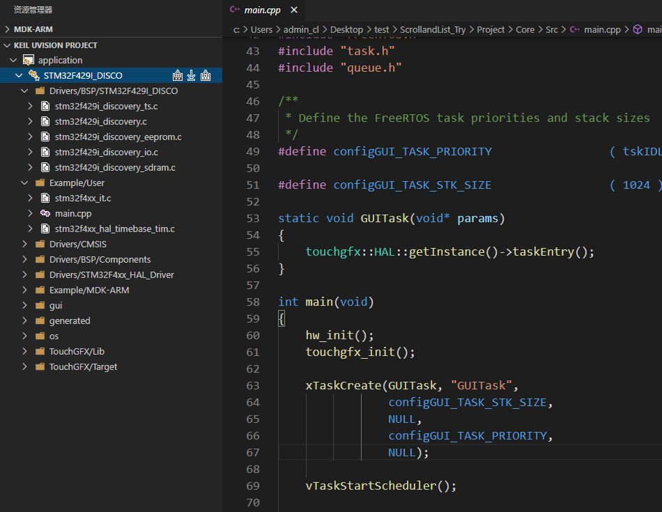
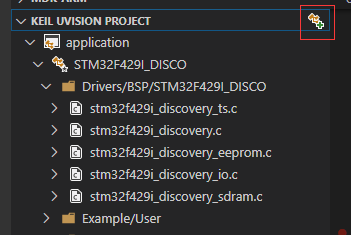
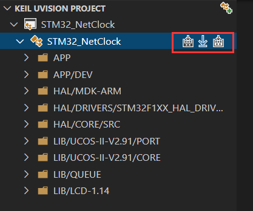
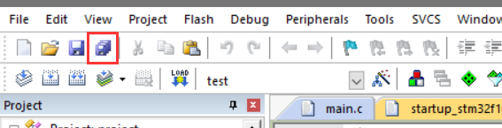
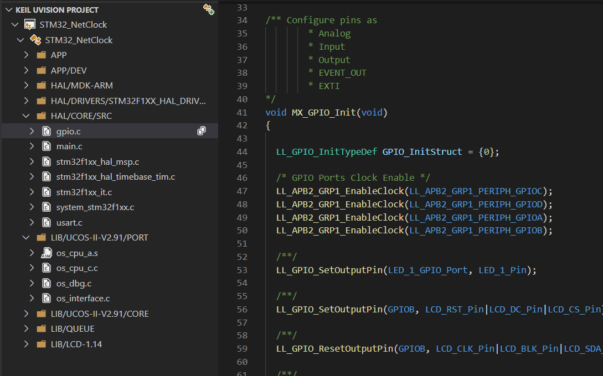
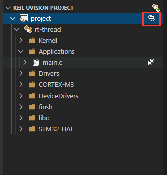
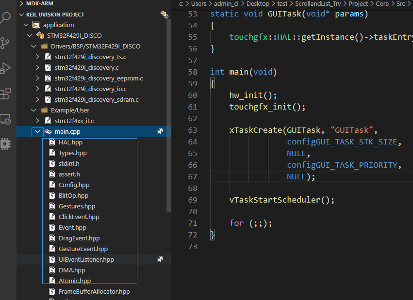

# Keil Assistant (优化版)

此仓库由 [Goal / qqzxc276869-bot](https://github.com/qqzxc276869-bot) 维护，基于 [原版 Keil Assistant](https://github.com/github0null/keil-assistant) 开发，改进了深层 Keil 工程的发现、VS Code 编译和工程文件管理。原版由 cl 开发，以 [MIT 许可证](./LICENSE)发布；本仓库保留原版权声明和许可证。此优化版与原作者发布的 VS Code Marketplace 版本不同。

## 相比原版的改动

原版需要在 Keil 中创建分组、添加文件，再保存工程供插件刷新。本版本增加了以下操作：

| 方面 | 优化版的改动 |
| --- | --- |
| 工程发现 | 递归查找工作区内深层 `.uvproj` / `.uvprojx`；多工程可按路径选择，手动选择会被记住；加载时保留外层源码工作区。 |
| 编译体验 | 状态栏显示当前工程与目标，提供编译、重新编译、编译并下载、重新编译并下载入口；编译前保存文件，下载前确认编译成功；同一工程的任务不会重叠运行。 |
| 工程管理 | 在 VS Code 中新建或删除 Keil 分组、一次添加多个已有文件、移除工程引用而保留磁盘文件；新建和从文件资源管理器拖入的 `.c` 文件可按目录自动加入工程，同目录头文件用于配置搜索路径。 |
| 编辑器配置 | 将 C/C++ IntelliSense 配置写入工程所属的 VS Code 工作区，保留已有 JSONC 注释和用户配置。 |

编译和下载仍使用本机安装的 Keil；新建分组和增删工程文件引用可直接在 VS Code 完成。

## 本地安装

安装 Node.js 和 Python，在仓库目录运行 `npm ci`、`npm test`，然后运行 `python scripts/package_vsix.py`。脚本完成检查和编译后，只在仓库目录生成一份 `keil-assistant-<版本号>.vsix`，供本地安装；不再制作 Marketplace 专用包。已有的旧版安装包不会因新版本打包而删除。

在 VS Code 中运行 **扩展: 从 VSIX 安装...**，选择生成的文件。需要 VS Code 1.41 或更新版本。此版的扩展标识为 `qqzxc276869-bot.keil-assistant-optimized`；如果已安装原版 `cl.keil-assistant`，建议先停用原版，避免两个扩展同时响应快捷键和工程视图。

## [English](./README_EN.md)

## 简介

Keil Assistant 在 VS Code 中显示 Keil C51/ARM 工程，并通过 Keil uVision 编译、重新编译和下载。配合 Microsoft C/C++ 扩展使用。仅支持 Windows 和 Keil uVision 5 及以上版本。

## 开始使用

1. 安装 VS Code 的 C/C++ 扩展。在 Keil Assistant 设置中，将 `KeilAssistant.MDK.Uv4Path`（ARM）或 `KeilAssistant.C51.Uv4Path`（C51）设为对应 `UV4.exe` 的绝对路径。
2. 用 VS Code 打开完整的工程文件夹。例如，打开包含 `Projects`、`Drivers` 的外层文件夹，无须只打开 `.uvprojx` 所在的深层目录。
3. 插件会递归发现工作区中的 `.uvproj` 和 `.uvprojx`。有多个候选工程时，按显示的相对路径选择要加载的工程。需要重新扫描时，在命令面板运行 **查找工作区中的 Keil 工程**。
4. 也可以点击项目视图中的打开图标，或运行 **打开 Keil 工程**，手动指定工程文件。手动打开不会切换当前工作区；选择会被记住，重新打开工作区时可继续加载。

## 常用操作

- **快捷操作**：点击状态栏中的工程与目标名称，可在已打开的 Keil 工程及其 Target 之间切换。状态栏提供编译、重新编译、编译并下载、重新编译并下载按钮；两个下载命令也显示在 Keil 工程视图顶部和目标行右侧。未打开工程时，状态栏提供打开入口。

- **编译、重新编译、下载**：项目视图仍提供原有按钮；`F7` 编译当前活动目标，`Ctrl+Alt+F7` 重新编译，`Ctrl+Alt+D` 直接下载。**编译并下载到设备** 和 **重新编译并下载到设备** 会先保存文件，等待对应编译及头文件路径修复后的重试成功，再执行 Keil `-f` 下载命令；编译失败、取消或缺少退出结果时停止下载。编译时，窗口底部状态栏显示逐步增长的百分比，最高到 95%；编译成功才显示 100%，失败则停在当时的数值。编译百分比根据运行时间估算，不代表已编译文件比例。三种下载方式也在底部状态栏显示进度条和阶段百分比：开始 0%、擦除完成 33%、写入完成 67%、校验完成 100%。这是**阶段进度**，不是写入字节的百分比；下载失败时不会补到 100%。快速完成或失败的提示会短暂保留，状态栏还会显示五秒钟的结果。下载完成后仍需查看 Keil 原始输出中的烧录与校验信息，插件无法单独确认开发板是否正常运行。

  

- **自动修复头文件搜索路径**：用插件编译时，如果 Keil 报找不到 `.h` / `.hpp` / `.inc`，插件会在当前工程的源码树中查找实际文件。只有一个匹配位置时，自动把正确目录加入该 Target 的 `IncludePath` 并重试编译；多个同名头文件时会请你选择。若头文件不在已知工程源码树中，插件会扩大到当前工作区搜索并请你确认。没有找到文件时会提示先复制文件。最多自动重试三次；仅修改需要修复的 Target。

- **新文件自动加入 Keil 工程**：在 VS Code 资源管理器中新建 `.c` 文件并首次保存后，插件按文件所在目录确定已加载的 Keil 工程、Target 和分组。从 Windows 文件资源管理器拖入工作区文件夹的 `.c` 文件也会被监听并自动加入；`.h` 文件不会写入分组，同目录有头文件时会补充 Keil 搜索路径。若已有分组对应上级文件夹，例如 `SYSTEM` 分组已包含 `SYSTEM/delay` 中的文件，新放入 `SYSTEM/lcd` 的 `.c` 文件也会归入 `SYSTEM`。没有父级归属时，才尝试同名分组或在唯一工程目标下新建分组。多个工程或目标无法唯一确定时会请你选择；首次选择的目录归属会被记住。需要更换分组时，按 `Ctrl+Shift+P` 搜索 **清除自动添加的文件夹分组记录**。可以通过 `KeilAssistant.Project.AutoAddNewFiles` 关闭自动添加。

- **补录已拖入的文件夹**：在 VS Code 资源管理器中右键文件夹，选择 **扫描文件夹并补入 Keil 工程**；也可从命令面板运行并选择文件夹。插件只扫描其中的 `.c` 文件，按文件夹匹配或新建分组，跳过已有引用。这适用于安装新版前已经复制完成、未触发新增事件的文件。

- **手动把已有文件加入 Keil 工程**：在 VS Code 资源管理器中选择一个或多个文件，右键选择 **将文件添加到 Keil 工程**；也可以从命令面板运行同名命令，在文件选择框中多选。依次选择已加载的 Keil 工程、Target 和分组，插件会一次更新工程文件，无须打开 Keil 单独添加。支持 `.c`、`.cpp`、`.s` / `.S`、`.asm`、`.a51`、`.h`、`.hpp`、`.inc`、`.lib` 等常见 Keil 文件；添加 C/C++ 头文件时，插件会把其所在目录加入所选 Target 的 Keil `IncludePath`（已存在时不会重复添加）。已有工程引用会提示所在分组，不会重复写入。

- **直接管理 Keil 工程树**：在插件的工程树中右键工程或 Target，选择 **新建 Keil 分组**；右键分组可选择 **将文件添加到 Keil 分组** 或 **删除 Keil 分组（保留磁盘文件）**。删除非空分组前会提示确认，分组内的工程引用会移除，磁盘文件保留。右键分组中的文件选择 **从 Keil 工程移除文件引用**，只移除单个引用。这些命令也能从命令面板运行。VS Code 自带资源管理器中的 **删除** 会删除磁盘文件。

- **在 Keil 中修改工程后刷新**：添加或删除源文件、修改头文件路径等操作后，在 Keil 中点击 **保存所有**。插件检测到工程文件变化后会刷新项目视图。

  

- **打开源文件**：单击以预览模式打开；双击以固定标签页打开。

  

- **切换目标**：点击项目的切换按钮选择 Keil Target。C/C++ 扩展的配置也可按目标选择。

  

- **查看引用**：ARM 工程编译后，可展开源文件项查看引用。

  

## VS Code 红色波浪线与 Keil 编译

插件在工程所属工作区的 `.vscode/c_cpp_properties.json` 中生成 C/C++ 配置，供编辑器识别 Keil 工程的头文件路径和宏。更新时会保留 JSONC 注释、其他配置和现有格式。红色波浪线是 IntelliSense 诊断，不等于 Keil 编译失败。遇到分歧时，先看 Keil 构建输出；若 Keil 编译成功，再检查所选 C/C++ 配置、芯片宏及头文件路径。

## 其他设置

- `KeilAssistant.Project.AutoAddNewFiles`：默认开启。VS Code 内新建并首次保存、或文件资源管理器向已打开工作区复制 `.c` 文件时，按目录自动加入 Keil 工程；可关闭该功能，继续使用手动添加命令。
- `KeilAssistant.Project.ExcludeList`：排除不需要发现的工程文件；可填写文件名或相对于工作区的路径，默认值为空列表 `[]`。
- `KeilAssistant.Project.FileLocationList`：可选，填写要加载的工程文件路径，用于明确指定工作区外或不便扫描的工程。

## 原项目

- [原版 Keil Assistant（已归档）](https://github.com/github0null/keil-assistant)
