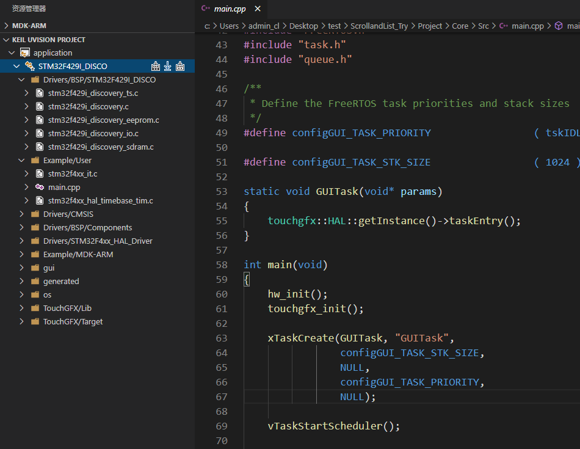
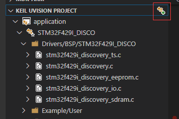
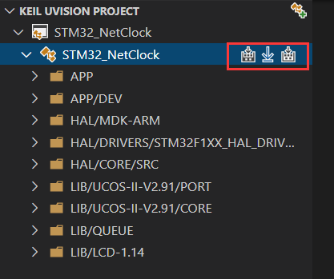
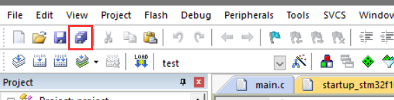
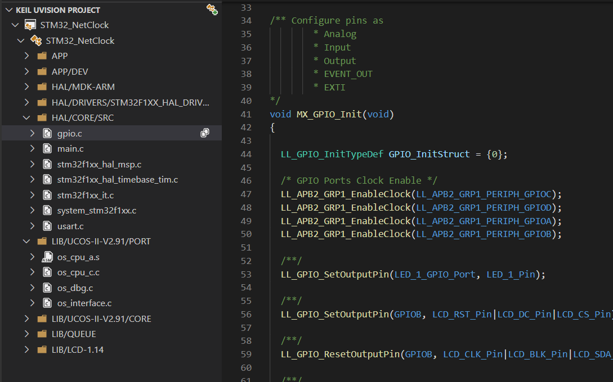
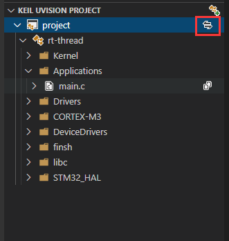
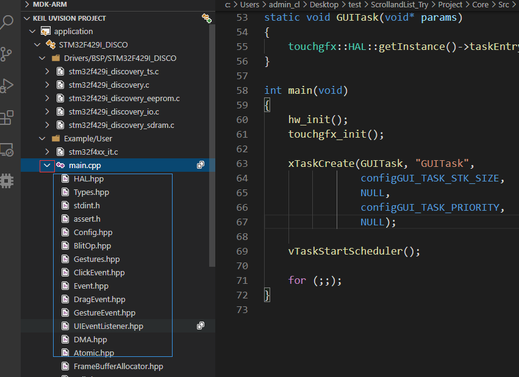

# Keil Assistant (Optimized)

此仓库由 [Goal / qqzxc276869-bot](https://github.com/qqzxc276869-bot) 维护，基于 [原版 Keil Assistant](https://github.com/github0null/keil-assistant) 开发，改进了深层 Keil 工程的发现、VS Code 编译和工程文件管理。原版由 cl 开发，以 [MIT 许可证](./LICENSE)发布；本仓库保留原版权声明和许可证。此优化版与原作者发布的 VS Code Marketplace 版本不同。

## 相比原版的改动

原版需要在 Keil 中创建分组、添加文件，再保存工程供插件刷新。本版本增加了以下操作：

| 方面 | 优化版的改动 |
| --- | --- |
| 工程发现 | 递归查找工作区内深层 `.uvproj` / `.uvprojx`；多工程可按路径选择，手动选择会被记住；加载时保留外层源码工作区。 |
| 编译体验 | 编译和重新编译前保存 VS Code 文件，从工程目录调用 `UV4.exe`，检查工具路径，并修复关闭工程后按 `F7` 的行为。 |
| 工程管理 | 在 VS Code 中新建 Keil 分组、向指定 Target 的分组添加已有 `.c` / `.h` 文件、移除工程引用而保留磁盘文件。 |
| 编辑器配置 | 将 C/C++ IntelliSense 配置写入工程所属的 VS Code 工作区。 |

编译和下载仍使用本机安装的 Keil。添加 `.h` 文件不会自动配置头文件搜索路径，需要时请在 Keil 工程设置中补充。

## 安装此修改版

从本仓库的 [Releases](https://github.com/qqzxc276869-bot/keil-assistant-optimized/releases) 下载 `.vsix`，在 VS Code 中运行 **Extensions: Install from VSIX...** 选择它。此版的扩展标识为 `qqzxc276869-bot.keil-assistant-optimized`；如果已安装原版 `cl.keil-assistant`，建议先停用原版，避免两个扩展同时响应快捷键和工程视图。

从源码构建：安装 Node.js 和 Python，运行 `npm install`、`npm run check`、`npm test`，然后运行 `python scripts/package_vsix.py` 生成 VSIX。

## [English](./README_EN.md)

## 简介

Keil Assistant 在 VS Code 中显示 Keil C51/ARM 工程，并通过 Keil uVision 编译、重新编译和下载。配合 Microsoft C/C++ 扩展使用。仅支持 Windows 和 Keil uVision 5 及以上版本。

## 开始使用

1. 安装 VS Code 的 C/C++ 扩展。在 Keil Assistant 设置中，将 `KeilAssistant.MDK.Uv4Path`（ARM）或 `KeilAssistant.C51.Uv4Path`（C51）设为对应 `UV4.exe` 的绝对路径。
2. 用 VS Code 打开完整的工程文件夹。例如，打开包含 `Projects`、`Drivers` 的外层文件夹，无须只打开 `.uvprojx` 所在的深层目录。
3. 插件会递归发现工作区中的 `.uvproj` 和 `.uvprojx`。有多个候选工程时，按显示的相对路径选择要加载的工程。需要重新扫描时，在命令面板运行 **Discover Keil Projects in Workspace**。
4. 也可以点击项目视图中的打开图标，或运行 **Open keil uVision project**，手动指定工程文件。手动打开不会切换当前工作区；选择会被记住，重新打开工作区时可继续加载。

## 常用操作

- **编译、重新编译、下载**：项目视图提供对应按钮；`F7` 编译当前活动目标，`Ctrl+Alt+F7` 重新编译。编译前会保存 VS Code 中未保存的文件。实际编译结果以 Keil 构建输出为准。

  

- **在 VS Code 中把新文件加入 Keil 工程**：创建 `.c` 或 `.h` 文件后，在 VS Code 资源管理器中右键该文件，选择 **Add File to Keil Project**；也可以先打开文件，再从命令面板运行同名命令。依次选择已加载的 Keil 工程、Target 和分组，插件会更新工程文件，无须打开 Keil 单独添加。`.c` 文件会参与所选 Target 的编译；`.h` 文件会显示在工程分组中，但添加头文件本身不会自动配置 `#include` 搜索路径，需要时仍要在工程中设置头文件目录。

- **直接管理 Keil 工程树**：在插件的工程树中右键工程或 Target，选择 **New Keil Group** 创建分组；右键分组选择 **Add File to Keil Group**，从磁盘选择已有的 `.c` 或 `.h` 文件；右键分组中的文件选择 **Remove File from Keil Project**，只从所选 Target 的工程分组移除引用，磁盘上的文件仍保留。VS Code 自带资源管理器中的 **删除** 是另一项操作，会删除磁盘文件。

- **在 Keil 中修改工程后刷新**：添加或删除源文件、修改头文件路径等操作后，在 Keil 中点击 **保存所有**。插件检测到工程文件变化后会刷新项目视图。

  

- **打开源文件**：单击以预览模式打开；双击以固定标签页打开。

  

- **切换目标**：点击项目的切换按钮选择 Keil Target。C/C++ 扩展的配置也可按目标选择。

  

- **查看引用**：ARM 工程编译后，可展开源文件项查看引用。

  

## VS Code 红色波浪线与 Keil 编译

插件在当前工作区根目录的 `.vscode/c_cpp_properties.json` 中生成 C/C++ 配置，供编辑器识别 Keil 工程的头文件路径和宏。红色波浪线是 IntelliSense 诊断，不等于 Keil 编译失败。遇到分歧时，先看 Keil 构建输出；若 Keil 编译成功，再检查所选 C/C++ 配置、芯片宏及头文件路径。

## 其他设置

- `KeilAssistant.Project.ExcludeList`：排除不需要发现的工程文件；可填写文件名或相对于工作区的路径，默认值为空列表 `[]`。
- `KeilAssistant.Project.FileLocationList`：可选，填写要加载的工程文件路径，用于明确指定工作区外或不便扫描的工程。

## 原项目

- [原版 Keil Assistant（已归档）](https://github.com/github0null/keil-assistant)
