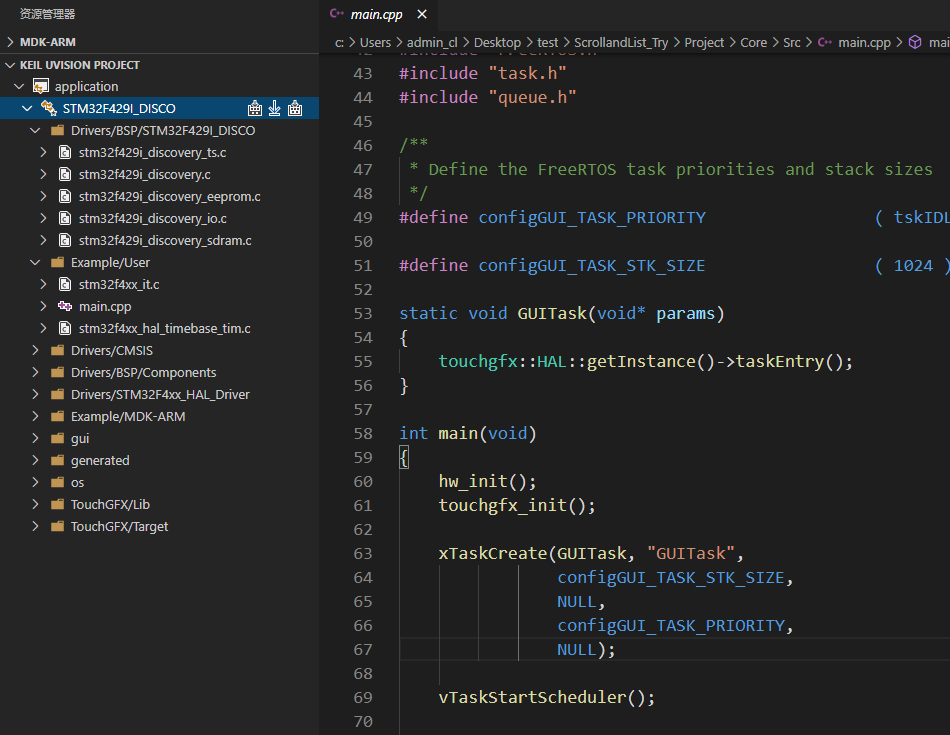
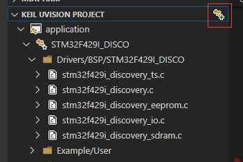
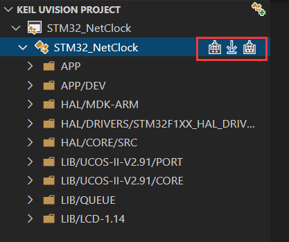
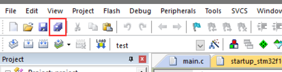
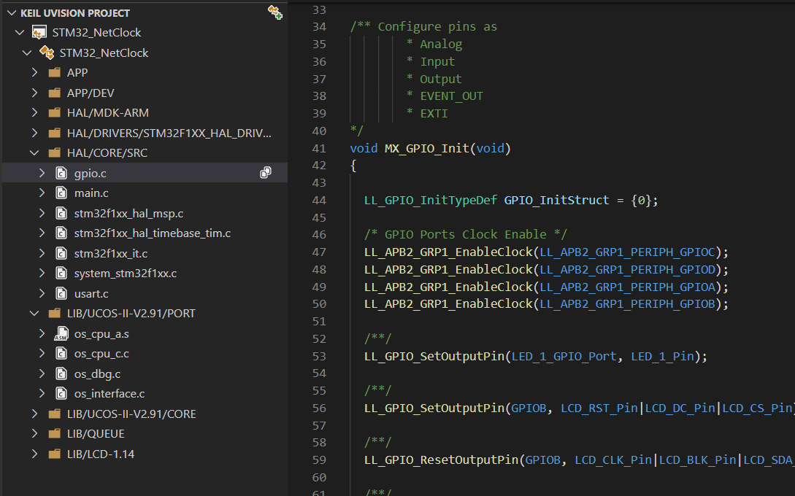
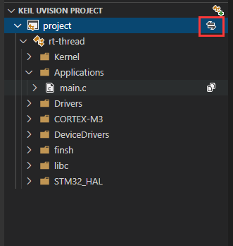
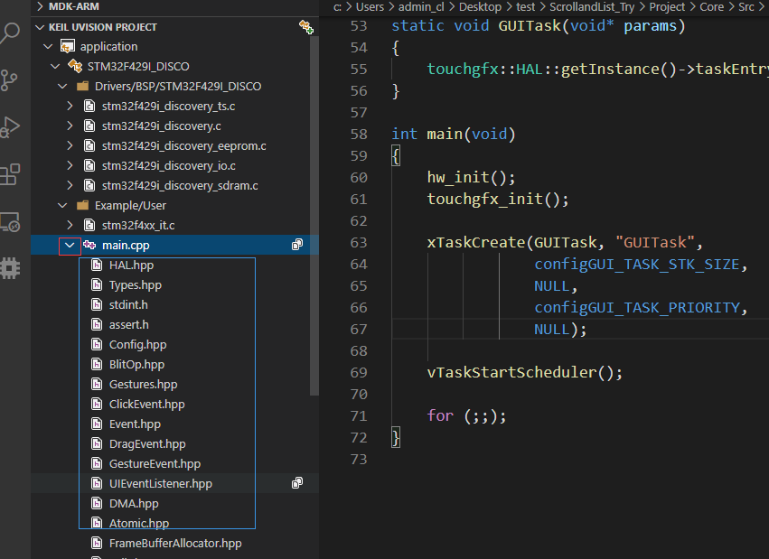

# Keil Assistant (优化版)

This repository is maintained by [Goal / qqzxc276869-bot](https://github.com/qqzxc276869-bot) and builds on the [original Keil Assistant](https://github.com/github0null/keil-assistant). It improves nested-project discovery, VS Code builds, and project-file management. The original was developed by cl under the [MIT License](./LICENSE); this repository retains its copyright and license notice. This optimized build is separate from the original author's VS Code Marketplace release.

## Changes from the original

The original workflow required creating groups and adding files in Keil, then saving the project so the extension could refresh. This version adds:

| Area | Improvements |
| --- | --- |
| Project discovery | Recursively find nested `.uvproj` / `.uvprojx` files, choose among projects by path, remember manually opened projects, and keep the outer source workspace open. |
| Builds | Show the active project and target in the status bar with build, rebuild, build-then-download, and rebuild-then-download actions. Save files before building, require a successful build before flashing, and prevent overlapping tasks. |
| Project management | Create Keil groups, add several existing C/C++, assembly, header, or library files to a chosen target and group at once, add newly created files by directory, remove project references without deleting disk files, and add header directories to the chosen target's IncludePath. |
| Editor configuration | Place C/C++ IntelliSense settings in the workspace containing the project while preserving JSONC comments and user configurations. |

Builds and downloads still use the locally installed Keil tools. Groups and file references can be managed in VS Code.

## Install locally

Install Node.js and Python. In the repository directory, run `npm ci` and `npm test`, then run `python scripts/package_vsix.py`. The script checks and builds the extension, then creates one local installer named `keil-assistant-<version>.vsix` in the repository directory. It does not create a separate Marketplace package. Packaging a new version does not delete installers for older versions.

In VS Code 1.41 or newer, run **Extensions: Install from VSIX...** and select that file. This build's extension ID is `qqzxc276869-bot.keil-assistant-optimized`. If the original `cl.keil-assistant` is installed, disable it first to avoid two extensions handling the same shortcuts and project view.

## [简体中文](./README.md)

## Overview

Keil Assistant displays Keil C51/ARM projects in VS Code and uses Keil uVision to build, rebuild, and download them. Use it with Microsoft's C/C++ extension. It supports Windows and Keil uVision 5 or later.

## Getting started

1. Install the C/C++ extension for VS Code. Set `KeilAssistant.MDK.Uv4Path` (ARM) or `KeilAssistant.C51.Uv4Path` (C51) to the absolute path of the corresponding `UV4.exe`.
2. Open the full source folder in VS Code. For example, keep an outer folder containing `Projects` and `Drivers` open instead of opening only the directory that contains a deeply nested `.uvprojx`.
3. The extension discovers `.uvproj` and `.uvprojx` files recursively in the workspace. If it finds several candidates, choose the project by its displayed relative path. Run **查找工作区中的 Keil 工程** from the Command Palette to scan again.
4. You can also use the open icon in the project view or run **打开 Keil 工程** to select a project file manually. Opening a project keeps the current workspace; your selection is remembered when the workspace is reopened.

## Common operations

- **Quick actions**: Click the status bar project and target label to switch among loaded Keil projects and targets. The status bar has build, rebuild, build then download, and rebuild then download actions. Both download sequences also appear in the Keil project view toolbar and on target rows. With no project loaded, the label opens one.

- **Build, rebuild, download**: The existing project-view buttons remain available. `F7` builds the active target, `Ctrl+Alt+F7` rebuilds, and `Ctrl+Alt+D` downloads directly. **编译并下载到设备** and **重新编译并下载到设备** save files and wait for a successful build or full rebuild, including any missing-header-path repair retry, before issuing Keil's `-f` download command. A failed or cancelled build stops the download. During builds, the bottom status bar shows a percentage that gradually rises to at most 95%; only a successful build shows 100%, while a failed build keeps its last value. The build percentage is estimated from elapsed time, not the proportion of files compiled. All three download paths show a bar and stage percentage in the bottom status bar: 0% at start, 33% when erase completes, 67% when programming completes, and 100% when verification completes. These are **completed download stages**, not a percentage of bytes written. A failed download does not advance to 100%. Fast completion or failure remains visible briefly, with a five-second status bar result. Check Keil's raw output for flashing results; the extension cannot independently confirm that the board is running correctly.

  

- **Repair missing header search paths automatically**: When a build run by the extension reports a missing `.h`, `.hpp`, or `.inc` file, the extension searches the project's source tree. A unique match adds the correct directory to that target's Keil `IncludePath` and retries the build. Duplicate names require your selection. A match found only in the wider workspace also requires confirmation. Missing files are reported so they can be copied into the project. Automatic retries are limited to three.

- **Automatically add new files**: Create a supported file in the VS Code Explorer and save it for the first time. The extension uses its directory to find the loaded Keil project, target, and group. If no existing project file identifies that directory, or multiple groups use it, choose a destination once; the choice is remembered for later files there. To change the choice, press `Ctrl+Shift+P` and run **清除自动添加的文件夹分组记录** from the Command Palette, or use the `…` menu at the top of the Keil project view. Choose the remembered directory; the next new file there can be assigned again. Files written directly to disk by a terminal or external tool do not trigger this workflow. File operations inside VS Code, including creations by other extensions through its edit API, may trigger it. Set `KeilAssistant.Project.AutoAddNewFiles` to `false` to turn it off.

- **Manually add existing files**: Select one or several files in the VS Code Explorer and choose **将文件添加到 Keil 工程**. You can also run the command from the Command Palette and select several files in the file picker. Choose the loaded Keil project, target, and group; the extension updates the project file in one operation. Supported types include `.c`, `.cpp`, `.s` / `.S`, `.asm`, `.a51`, `.h`, `.hpp`, `.inc`, and `.lib`. Adding a C/C++ header also adds its directory to the chosen target's Keil `IncludePath`, without duplicating an existing path. Files already in the project are reported with their existing group.

- **Manage the Keil project tree directly**: Right-click a project or target in the extension's project tree and choose **新建 Keil 分组** to create a group. Right-click a group and choose **将文件添加到 Keil 分组** to select several existing files from disk. Right-click a file in a group and choose **从 Keil 工程移除文件引用** to remove its reference from that target's project group while keeping the disk file. These commands also work from the Command Palette and prompt for the missing project, group, or file. **Delete** in VS Code's built-in Explorer is a separate action that deletes the disk file.

- **Refresh after changing the project in Keil**: After adding or removing source files or editing include paths in Keil, click **Save All** there. The project view refreshes when the extension detects the project file change.

  

- **Open a source file**: Single click opens a preview; double click keeps the editor tab open.

  

- **Switch targets**: Use the switch button on a project to select a Keil target. You can select the corresponding C/C++ configuration too.

  

- **Inspect references**: After building an ARM project, expand a source item to see its references.

  

## VS Code diagnostics and Keil builds

The extension generates `.vscode/c_cpp_properties.json` in the workspace containing the project so the editor can read its include paths and defines. Updates preserve JSONC comments, other configurations, and existing formatting. Red squiggles come from IntelliSense and do not by themselves mean the Keil build failed. Check the Keil build output first; if it succeeds, inspect the selected C/C++ configuration, device defines, and include paths.

## Other settings

- `KeilAssistant.Project.AutoAddNewFiles`: Enabled by default. When a supported file is created in VS Code and saved for the first time, add it to the Keil project using its directory. Turn this off to use only the manual add commands.
- `KeilAssistant.Project.ExcludeList`: Excludes projects from discovery by filename or workspace-relative path. The default is an empty list, `[]`.
- `KeilAssistant.Project.FileLocationList`: Optional project file paths for projects outside the workspace or paths that are inconvenient to scan.

## Original project

- [Original Keil Assistant (archived)](https://github.com/github0null/keil-assistant)
